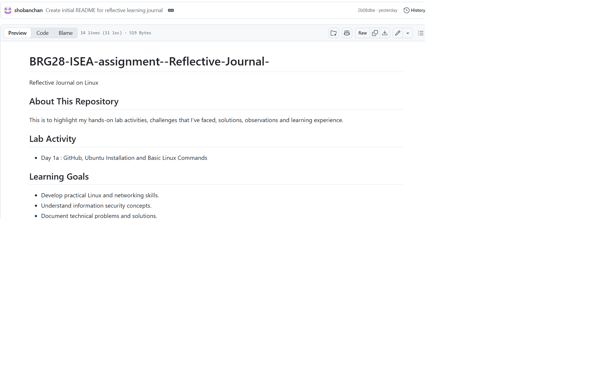

# Day 1a : Introduction to GitHub
## Lab Ojective

The objective of this activity was to become familiar with GitHub and understand how repositories can be used to document laboratory activities, track changes, and record learning progress.

## Activites Performed

1) I accessed Github.com and created am account. From there , i created a repository named BRG28-ISEA-assignment--Reflective-Journal-.
2) I then created a README.md file using GitHub's online editor. 
3) An introduction to my repository, a summary of my lab activities, and my learning objectives are all included in the file.
4) I made my first commit after making adjustments to the README file.
5) Cloning my GitHub repository to my local machine by installing Git. 
6) I then opened Command Prompt and used the following command to clone my GitHub repository:
   git clone https://github.com/shobanchan/BRG28-ISEA-assignment--Reflective-Journal-.git
   After cloning, I navigated into the repository directory and executed:
   git status

## Observation 

Being new to GitHub, i didn't understand what is the function of GitHub and the relantionship between Git and GitHub. Everything was foriegn to me. With the help of Youtube and Chatpgt , i understood the functionality of GitHUb.
I observed the function of "markdown" and usage for formatting documentation. For example, the # symbol creates headings, while hyphens can be used to create bullet points.
"Commit" records changes through commit, allowing users to review the development of the project.
I learned the difference between Git and GitHub. Git is a version-control tool that tracks changes locally, while GitHub hosts repositories online.
I also learned that cloning creates a local copy of a repository, allowing me to work on project files directly from my laptop. Furthermore, as i continue working on GitHub online, using the - git pull- command on cmd will save my progress locally. 

## Challenges Encounterd

Asforementioned, the initial stages to understand GIt and create a repository was rather confusing for me. Fiddling around the GUI helped me understand what GitHub is about and how useful it can be.
had difficulty locating my repository because I was viewing the GitHub Copilot dashboard. After navigating to the repository's main page, I was able to create and edit the README file.
I faced an issue for pasting my screenshot on GITHub. Microsoft manner for sniping and pasting is entierly differernt for GIT.

## Reflection and Learning
Through this activity, I began to understand the difference between GitHub, repositories, README files, and commits.

This activity helped me understand how it can serve as a platform for recording my laboratory experiences and developing a portfolio of technical projects which can benefit me in the near future.

## Evidence

### Screenshot 1: GitHub Repository Creation

### Screenshot 2: README File

### Screenshot 3: First Commit

### Screenshot 4: Git Installation

### Screenshot 5: Git Clone

### Screenshot 6: Git Version Verification

# Day 1a : Introduction to Ubuntu Linux

## Lab Objectives
The ojective was to install a VM plus Unbuntu Linux in a virtual environment and become familiar with the Linux operating system. 

## Activites Performed
1) Download Ubuntu ISO
2) Install VirtualBox and create a new virtual machine.
3) Configure VM settings
4) Mount ISO and install Ubuntu through guided installer

## Challenges Encountered
Orginally 
##Observations

##What I learned

##Screenshots and Evidence

  

 

 

 

  

 
