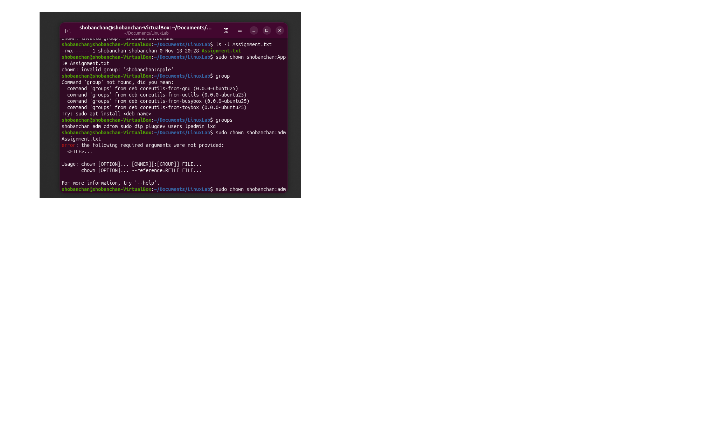

# Lab 1b – Reflective Learning Journal

## Part 1: Linux Services

### Lab Objectives
- Understand how Linux manages background services.
- List services using `systemctl`.
- Check service status.
- Start and stop services using `sudo systemctl`.

### Activities Performed

```bash
systemctl list-units --type=service
systemctl status cron
sudo systemctl stop cron
sudo systemctl start cron
systemctl is-active cron
```

### Observations

During this lab, I learned that Linux uses background services to perform system tasks.

- **SSH:** Allows remote connections to Linux computers.
- **Apache2:** Runs a web server.
- **cron:** Executes scheduled tasks.
- **systemctl:** Manages Linux services.

I learned that `systemctl` can list, monitor, start and stop services.

### Challenges Encountered

Initially, I entered `systemctl list-units --type=services`, which returned an error.

I discovered that the correct command was `systemctl list-units --type=service`.

This taught me that Linux commands require accurate syntax.

### Reflection and Learning

I learned how Linux manages background processes and how system administrators can monitor services using `systemctl`. I also understood that `sudo` provides administrator privileges when required.

### Evidence

#### Screenshot 1: Listing Linux Services


#### Screenshot 2: Stopping the Cron Service


#### Screenshot 3: Restarting the Cron Service


---

## Part 2: Linux Permissions and Searching Filesystems

### Lab Objectives
- Understand file permissions and ownership.
- View permissions using `ls -l`.
- Modify permissions using `chmod`.
- Change ownership using `chown`.
- Locate files using `find`.
- Search file contents using `grep`.

### Activities Performed

**1. Linux Permissions**

```bash
cd ~/Documents/LinuxLab
ls -l
chmod 755 Assignment.txt
ls -l Assignment.txt
chmod 640 Assignment.txt
ls -l Assignment.txt
```

**2. File Ownership**

```bash
sudo chown shobanchan:adm Assignment.txt
ls -l Assignment.txt
sudo chown shobanchan:shobanchan Assignment.txt
ls -l Assignment.txt
```

**3. Searching Filesystems**

```bash
find ~/Documents/LinuxLab -name "notes.txt"
echo "Hello world" >> notes.txt
cat notes.txt
grep "world" notes.txt
grep -r "world" ~/Documents/LinuxLab/
```

### Observations

**Linux Permissions**

I observed that `ls -l` displays file permissions, ownership and other file information.

Linux permissions are divided into three categories:

1. **Owner:** The user who owns the file.
2. **Group:** Users belonging to the file's group.
3. **Others:** All other users.

I learned that Linux uses binary values to represent permissions.

| Permission | Binary | Decimal |
|---|---|---|
| Read | 100 | 4 |
| Write | 010 | 2 |
| Execute | 001 | 1 |
| Read + Write | 110 | 6 |
| Read + Execute | 101 | 5 |
| Read + Write + Execute | 111 | 7 |

For example, `chmod 640 Assignment.txt` means:

- Owner (6): Read and write.
- Group (4): Read only.
- Others (0): No permissions.

**File Ownership**

I learned that `chmod` changes file permissions, whereas `chown` changes the file owner and group.

**Searching Filesystems**

I successfully used `find` to locate `notes.txt` in my LinuxLab directory.

I also added "Hello world" to the file and used `grep` to search for the word "world".

I learned that `find` locates files, while `grep` searches their contents.

### Challenges Encountered

**1. Understanding Binary Permissions**

Initially, I struggled to understand how values such as 777, 755 and 640 were calculated.

I learned that Linux permissions use three binary positions with values 4, 2 and 1.

For example:

`111 = 4 + 2 + 1 = 7`

**2. Invalid Group Error**

When using `chown`, I attempted to assign a file to a group named `Apple`.

Linux returned an "invalid group" error because the group did not exist.

I learned that `chown` requires a valid user and group.

**3. Incorrect Directory Path**

While practising `grep`, I mistakenly entered:

`~Documents/LinuxLab/`

Instead of:

`~/Documents/LinuxLab/`

Linux returned a "No such file or directory" error.

**4. Incomplete Quotation Marks**

I also entered a `grep` command with an incomplete quotation mark.

The terminal displayed the `>` prompt and waited for more input.

I used `Ctrl + C` to cancel the command and corrected the syntax.

These mistakes helped me understand the importance of accurate command syntax and troubleshooting.

### Reflection and Learning

Through this lab, I gained a better understanding of Linux file permissions, ownership and filesystem searching.

I learned how binary values determine file access permissions and how `chmod` and `chown` are used to manage access control.

I also learned how `find` and `grep` help locate files and search for information.

Overall, this activity improved my confidence in using Linux commands and understanding basic system administration and cybersecurity concepts.

### Evidence


### Evidence

#### Screenshot 4: Viewing File Permissions


#### Screenshot 5: Changing File Ownership


#### Screenshot 6: Exploring File Ownership


#### Screenshot 7: Searching Files Using Find


#### Screenshot 8: Searching File Contents Using Grep


