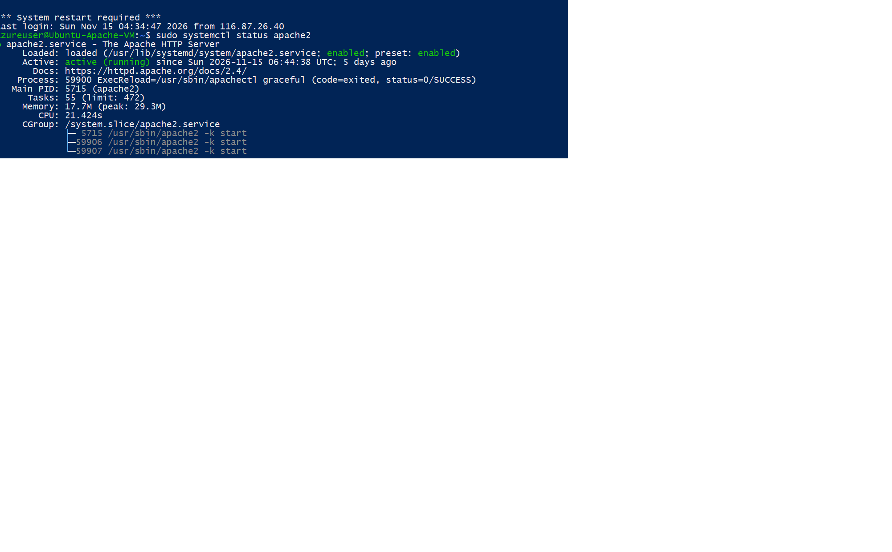
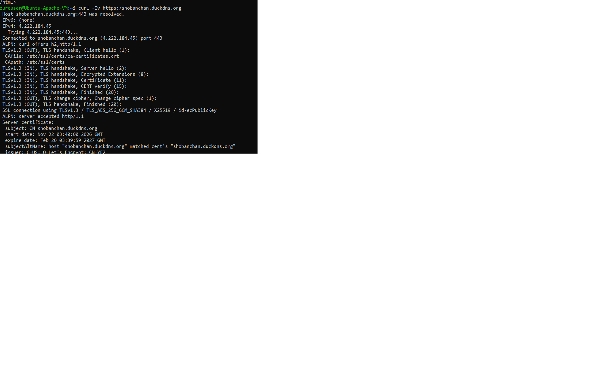
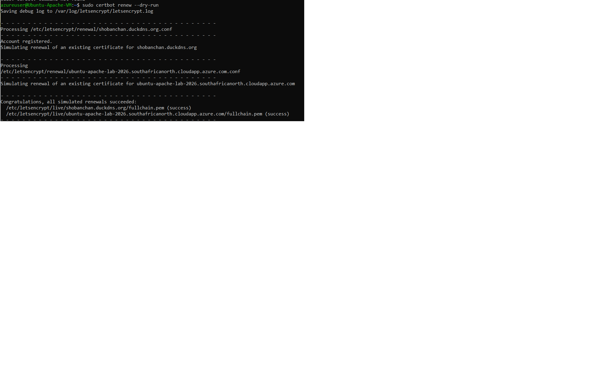

# Lab 2a-2: Deploying an Apache Web Server on a Cloud Virtual Machine

## Objective

The objective of this lab was to deploy a Linux virtual machine in a cloud environment, configure network access, install and manage Apache, and verify that a webpage could be accessed through a public IP address.

I initially attempted the lab using AWS EC2 before switching to Microsoft Azure, which was also permitted for the assignment.

This lab established the cloud infrastructure and Apache web server that I subsequently reused in **Lab 3a-1: Domain, DNS and TLS Certificates with Let's Encrypt**.

## Environment and Tools

- AWS EC2 (initial attempt)
- Microsoft Azure Virtual Machines (completed deployment)
- Ubuntu Server 24.04 LTS
- Apache2 HTTP Server
- Windows PowerShell and SSH
- Azure Network Security Group (NSG)
- Nano text editor
- Web browser

## Part 1: Initial AWS EC2 Deployment

I created an AWS account and launched an EC2 instance in the Sydney region. I configured a security group with SSH on TCP port 22 restricted to My IP and HTTP on TCP port 80 accessible from anywhere (`0.0.0.0/0`).

I attempted to connect through browser-based EC2 Instance Connect but received an SSH connection error.

To investigate, I checked the instance status, public IPv4 address, security group rules, subnet, route table, Internet Gateway and Network ACL.

The instance was running, and the network configuration showed an Internet Gateway route and permissive Network ACL rules.

I then attempted SSH through Windows PowerShell. An authentication error led me to check the AMI name.

I discovered that I had selected **Amazon Linux 2023 rather than Ubuntu**.

Amazon Linux uses the default username `ec2-user`, whereas Ubuntu commonly uses `ubuntu`.

Using `ec2-user` allowed me to connect to the original Amazon Linux instance.

I subsequently attempted a new Ubuntu deployment and experimented with a new SSH key pair. However, browser-based SSH connectivity remained unresolved.

As Azure was permitted for this assignment, I decided to continue using my existing Azure Ubuntu virtual machine.

## Part 2: Azure Virtual Machine

I reused an existing Azure virtual machine with the following configuration:

| Property | Configuration |
|---|---|
| VM name | Ubuntu-Apache-VM |
| Resource group | RG-Ubuntu-Lab |
| Operating system | Ubuntu 24.04 LTS |
| Region | South Africa North |
| VM size | Standard B2ats v2 |
| CPU | 2 vCPUs |
| Memory | 1 GiB |
| Public IPv4 | 4.222.184.45 |
| Private IPv4 | 172.16.0.4 |

The virtual machine provided the cloud computing environment for hosting my Apache website.

I later reused this same VM in Lab 3a-1 to configure DNS and HTTPS.

## Part 3: Connecting Through SSH

I verified that Azure allowed SSH access on TCP port 22.

I located the private key downloaded when the VM was created and used Windows PowerShell to connect.

```powershell
cd "$HOME\Downloads"
ssh -i ".\Ubuntu-Apache-VM_key.pem" azureuser@4.222.184.45
```

The Ubuntu welcome message and the `azureuser@Ubuntu-Apache-VM:~$` prompt confirmed that I had connected to the remote Linux virtual machine.

SSH allowed me to administer the cloud VM securely without needing physical access to the server.

## Part 4: Verifying Apache

The Apache web server was already installed on my existing Azure VM.

I verified its status using:

```bash
sudo systemctl status apache2
```

The result displayed `active (running)`, confirming that Apache was operating as a Linux service.

I also opened the VM public IP address in a browser:

```text
http://4.222.184.45
```

The Apache default page loaded successfully, confirming that the server was reachable through HTTP on port 80.

At this stage, the website was accessible through its public IP address but did not yet have the DuckDNS hostname and HTTPS configuration introduced in Lab 3a-1.

## Part 5: Exploring and Editing the Webpage

I listed the default Apache website directory:

```bash
ls /var/www/html
```

The directory contained `index.html`.

I examined the file using:

```bash
cat /var/www/html/index.html
```

I opened the file for editing:

```bash
sudo nano /var/www/html/index.html
```

I replaced the default page with the following HTML:

```html
<!DOCTYPE html>
<html>
<head>
    <title>My Azure Apache Lab</title>
</head>
<body>
    <h1>Hello from Azure Ubuntu Apache!</h1>
    <p>Lab 2a-2 completed successfully.</p>
    <p>This website is hosted on my Azure virtual machine.</p>
</body>
</html>
```

I saved the file using `Ctrl+O`, confirmed with Enter, and exited Nano using `Ctrl+X`.

After refreshing the browser, my custom webpage appeared successfully.

This same HTML webpage was later used in Lab 3a-1 to demonstrate access through a domain name and an encrypted HTTPS connection.

## Challenges Encountered

### Challenge 1: Incorrect AWS Operating System

I initially selected Amazon Linux 2023 instead of Ubuntu Server.

I attempted to connect using the `ubuntu` username and received a `Permission denied` error.

After checking the AMI name, I identified the operating system mismatch. Using `ec2-user` allowed me to connect to the original instance.

This taught me that Linux distributions can have different default SSH usernames and package managers.

### Challenge 2: AWS Browser-Based SSH Connection Failure

EC2 Instance Connect repeatedly displayed an error establishing an SSH connection.

I investigated the security group, public IP, VPC, subnet, Internet Gateway, route table and Network ACL.

I learned that an EC2 instance can be running and pass its health checks while remote access still fails.

I also learned that browser-based EC2 Instance Connect and direct SSH from PowerShell can have different network access requirements.

The browser connection issue was not conclusively resolved.

### Challenge 3: SSH Command and Key File Errors

While troubleshooting AWS, I encountered `Permission denied (publickey)` and hostname resolution errors.

I learned that the username, destination IP address and private key must all be correct.

I also encountered a missing private key file warning and learned to check the current directory and key filename before attempting SSH.

### Challenge 4: Understanding Cloud Networking

Initially, I found it difficult to understand the relationship between a VPC, subnet, route table, Internet Gateway, Security Group and Network ACL.

Investigating each component helped me understand that a public IP alone does not guarantee connectivity.

Network routing and firewall permissions also need to be configured correctly.

### Challenge 5: Editing HTML in Nano

The original Apache `index.html` contained a large amount of HTML and CSS.

I was initially unsure which sections to remove.

I replaced the original contents with a simpler HTML page and successfully displayed my custom message.

I noticed that the original colours and formatting disappeared because the replacement page did not include CSS.

This helped me understand the difference between HTML content and CSS presentation.

## Key Learning Outcomes

- Understood the purpose of cloud-hosted Linux virtual machines.
- Learned the difference between Amazon Linux and Ubuntu.
- Practised SSH authentication using a private key.
- Understood the roles of public and private IP addresses.
- Investigated cloud routing and firewall configurations.
- Verified Apache using `systemctl`.
- Located and edited the default Apache webpage.
- Learned how HTML and CSS affect webpage content and appearance.
- Successfully accessed a custom webpage hosted on Azure through a public IP address.
- Established the cloud infrastructure required for the subsequent DNS and TLS lab.

## Screenshots and Evidence

### Screenshot 1: Azure Virtual Machine Configuration

The screenshot shows the configuration of my Azure Ubuntu virtual machine, including its operating system, resource group, public IP address and virtual network settings.


### Screenshot 2: Azure Ubuntu Virtual Machine

This screenshot shows my Ubuntu virtual machine deployed on Microsoft Azure. I used this environment to complete the Apache web server lab.


### Screenshot 3: Apache Service Status

I used `sudo systemctl status apache2` to verify that the Apache web server was running successfully.

The service displayed `active (running)`.



### Screenshot 4: Apache Default Webpage

After verifying the Apache service, I entered the virtual machine's public IP address into my web browser.

The Apache2 Ubuntu Default Page loaded successfully, confirming that the web server was accessible through HTTP.


### Screenshot 5: Apache Website Directory

I used the following command to examine the default Apache website directory:

```bash
ls /var/www/html
```

The directory contained `index.html`, which is the default webpage served by Apache.


### Screenshot 6: Modified Apache Webpage

I edited `/var/www/html/index.html` using the Nano text editor and replaced the default Apache webpage with my own HTML content.

After saving the changes and refreshing my browser, the updated webpage appeared successfully.


## Conclusion

This lab helped me understand how cloud virtual machines, SSH, network security and web servers work together.

Although my initial AWS deployment involved several SSH and operating system configuration challenges, troubleshooting those issues improved my understanding of cloud networking and remote administration.

I completed the practical web hosting exercise using Microsoft Azure, where I verified Apache and successfully modified and accessed my own HTML webpage.

The experience reinforced the importance of checking the operating system, authentication credentials, network rules and service status when troubleshooting cloud environments.

The successful Apache deployment provided the foundation for the next lab, where I extended the same Azure VM by configuring a domain name, DNS resolution and HTTPS using Let's Encrypt.

---

# Lab 3a-1: Domain, DNS and TLS Certificates with Let's Encrypt

## Objective

The objective of this lab was to extend the existing Apache web server deployment from Lab 2a-2 by configuring a domain name, verifying DNS resolution and securing the website using HTTPS with a Let's Encrypt TLS certificate.

Instead of creating another virtual machine, I reused the existing Azure Ubuntu VM and Apache installation.

This allowed me to focus on understanding how domain names, DNS records, Apache virtual hosts and TLS certificates work together to provide secure access to a publicly hosted website.

## Environment and Tools

- Microsoft Azure Virtual Machines
- Ubuntu Server 24.04 LTS
- Apache2 HTTP Server
- Azure Network Security Group
- DuckDNS
- Azure-provided DNS hostname
- Let's Encrypt
- Certbot and Apache plugin
- Ubuntu Bash terminal
- Windows PowerShell
- `nslookup`
- `curl`
- Nano text editor
- Google Chrome

## Part 1: Existing Azure Infrastructure

I reused the Azure virtual machine deployed in Lab 2a-2.

| Property | Configuration |
|---|---|
| VM name | Ubuntu-Apache-VM |
| Resource group | RG-Ubuntu-Lab |
| Region | South Africa North |
| Public IPv4 | 4.222.184.45 |
| Web server | Apache2 |
| Website directory | /var/www/html |
| HTTP port | 80 |
| HTTPS port | 443 |
| SSH port | 22 |

The Apache website was already accessible through:

```text
http://4.222.184.45
```

The existing webpage displayed:

**Hello from Azure Ubuntu Apache!**

I verified that the VM was running and that the required inbound network security rules were configured.

## Part 2: Domain Name Configuration

### 2.1 Azure DNS Hostname

I had previously configured an Azure-provided DNS hostname:

```text
ubuntu-apache-lab-2026.southafricanorth.cloudapp.azure.com
```

This hostname was associated with my Azure VM and had previously been used for HTTPS configuration.

During subsequent DNS testing, I encountered an `NXDOMAIN` response when querying this hostname.

I continued the lab using DuckDNS, which successfully resolved to my Azure VM.

### 2.2 Registering a DuckDNS Hostname

I created a free DuckDNS hostname:

```text
shobanchan.duckdns.org
```

I configured the hostname to point to my Azure VM's public IP address:

```text
4.222.184.45
```

This provided a readable hostname for accessing the Apache website.

### 2.3 Understanding DNS

DNS stands for Domain Name System.

Its purpose is to translate human-readable domain names into IP addresses.

For my website, the DNS mapping was:

```text
shobanchan.duckdns.org
          |
          v
     4.222.184.45
          |
          v
     Azure Ubuntu VM
          |
          v
      Apache2 Server
```

## Part 3: Verifying DNS Resolution

I tested the DuckDNS hostname using `nslookup`.

Initially, my default DNS resolver produced a timeout.

To investigate, I used Google's public DNS server:

```bash
nslookup shobanchan.duckdns.org 8.8.8.8
```

The lookup succeeded and returned the Azure VM's public IP address:

```text
4.222.184.45
```

This confirmed that the DuckDNS hostname resolved correctly.

I then accessed the website using:

```text
http://shobanchan.duckdns.org
```

The Apache webpage loaded successfully.

This demonstrated that DNS resolution and HTTP website access were working.

## Part 4: Obtaining a Let's Encrypt TLS Certificate

### 4.1 Understanding HTTPS

HTTP allows communication between a browser and web server without transport encryption.

HTTPS uses TLS to encrypt communication and authenticate the server.

For this lab, I used Let's Encrypt, a free Certificate Authority, to obtain a trusted TLS certificate.

### 4.2 Using Certbot

Certbot was used to request and manage the certificate.

I ran:

```bash
sudo certbot --apache -d shobanchan.duckdns.org
```

Let's Encrypt successfully issued a certificate for the DuckDNS hostname.

However, Certbot initially could not identify the appropriate Apache virtual host for installing the certificate.

The existing Apache HTTPS configuration was associated with my Azure hostname.

This required additional Apache configuration.

## Part 5: Configuring Apache Virtual Hosts

### 5.1 Creating a DuckDNS Virtual Host

I created a separate Apache configuration file:

```bash
sudo nano /etc/apache2/sites-available/duckdns.conf
```

The configuration contained:

```apache
<VirtualHost *:80>
    ServerName shobanchan.duckdns.org
    DocumentRoot /var/www/html
</VirtualHost>
```

The `ServerName` directive identifies the hostname associated with the virtual host.

The `DocumentRoot` directive specifies the location of the website files.

I reused `/var/www/html`, which contained the webpage created in Lab 2a-2.

### 5.2 Enabling the Configuration

I enabled the virtual host:

```bash
sudo a2ensite duckdns.conf
```

I checked the Apache configuration:

```bash
sudo apache2ctl configtest
```

I then reloaded Apache:

```bash
sudo systemctl reload apache2
```

### 5.3 Installing the TLS Certificate

After configuring the virtual host, I used Certbot to install the existing certificate.

```bash
sudo certbot install --cert-name shobanchan.duckdns.org --apache
```

I verified the Apache virtual hosts using:

```bash
sudo apache2ctl -S
```

The output showed that Apache recognised `shobanchan.duckdns.org` on ports 80 and 443.

I also checked the certificate configuration using:

```bash
sudo grep -E 'ServerName|SSLCertificateFile|SSLCertificateKeyFile' /etc/apache2/sites-enabled/duckdns-le-ssl.conf
```

The output confirmed that the DuckDNS HTTPS virtual host referenced the correct certificate and private key files.

## Part 6: Verifying HTTPS

I tested the HTTPS connection using:

```bash
curl -Iv https://shobanchan.duckdns.org
```

The result confirmed:

- TLS version: TLS 1.3
- Certificate Authority: Let's Encrypt
- Certificate hostname: shobanchan.duckdns.org
- Certificate verification: Successful
- Certificate expiry: 20 February 2027

The output included:

```text
SSL certificate verify ok.
```

I then accessed the website in Chrome:

```text
https://shobanchan.duckdns.org
```

The browser successfully established a secure HTTPS connection.

## Part 7: Testing Certificate Renewal

I tested the certificate renewal process using:

```bash
sudo certbot renew --dry-run
```

The renewal simulation completed successfully.

This confirmed that Certbot could successfully perform a simulated certificate renewal without replacing the active certificates.

## Part 8: Challenges Encountered

### Challenge 1: DNS Timeout

The initial DNS lookup timed out when using the default DNS resolver.

I tested Google's DNS server directly using:

```bash
nslookup shobanchan.duckdns.org 8.8.8.8
```

The lookup succeeded.

This taught me how alternative DNS resolvers can be used to troubleshoot DNS problems.

### Challenge 2: Azure Hostname NXDOMAIN

While testing the Azure hostname, I received an `NXDOMAIN` response.

This indicated that the DNS resolver could not find the requested hostname.

I continued using DuckDNS, which resolved successfully.

### Challenge 3: Apache Virtual Host Selection

Certbot initially issued the DuckDNS certificate but could not automatically select the correct Apache virtual host.

I created a separate Apache virtual host configuration for the DuckDNS hostname.

This helped me understand how one Apache server can support multiple hostnames.

### Challenge 4: Nano File Path Error

While editing the Apache configuration, I encountered:

```text
Error writing sites-available/duckdns.conf:
No such file or directory
```

I corrected the file path by using:

```text
/etc/apache2/sites-available/duckdns.conf
```

This taught me the importance of absolute file paths when editing Linux configuration files.

### Challenge 5: Browser Security Warning

After installing the certificate, Chrome initially displayed a security warning in normal browsing mode.

However, the website appeared secure in Incognito mode.

I investigated the browser-side issue and resolved it without reinstalling the TLS certificate.

The successful `curl` certificate verification helped me distinguish the browser problem from the server configuration.


## Part 10: Reflection Questions

### Question 1: What is the role of DNS in Internet presence?

DNS translates readable domain names into IP addresses.

In this lab, DNS allowed my Azure website to be accessed through `shobanchan.duckdns.org` rather than requiring users to remember the public IP address.

### Question 2: Why does DNS propagation take time?

DNS resolvers cache records for a period determined by their time-to-live values.

When a DNS record changes, some resolvers may continue using older cached information until it expires.

This can delay the visibility of DNS updates.

### Question 3: How does Let's Encrypt validate domain ownership?

Let's Encrypt validates that the certificate requester controls the domain.

For HTTP-01 validation, it requests a specific challenge response from the web server using the requested hostname.

Successful validation allows Let's Encrypt to issue a certificate.

### Question 4: What are the risks if TLS is not configured on a public-facing site?

Without TLS, HTTP traffic is not encrypted.

Potential risks include:

- Exposure of sensitive information.
- Interception of login credentials.
- Modification of transmitted content.
- Man-in-the-middle attacks.
- Reduced confidence in the website's identity.

HTTPS helps protect communication confidentiality, integrity and server authentication.

### Question 5: What could happen if you leave your cloud VM running for months?

Leaving a cloud VM running can result in ongoing cloud charges.

Potential costs include compute, storage, networking and public IP resources.

A public-facing VM may also remain exposed to security threats if software and security settings are not maintained.

It is important to monitor costs, apply updates and stop or delete unused resources.

## Part 11: Screenshots and Evidence

### Screenshot 1: DuckDNS Domain Configuration

This screenshot shows the DuckDNS hostname configured to point to my Azure VM's public IP address.


### Screenshot 2: DNS Resolution

This screenshot shows the successful DNS lookup 


### Screenshot 3: Apache Website Through Domain

This screenshot shows my Apache webpage accessed through the DuckDNS hostname.


### Screenshot 4: Let's Encrypt Certificate

This screenshot shows the certificate issued for the DuckDNS hostname.


### Screenshot 6: HTTPS Certificate Verification

This screenshot shows the successful TLS certificate verification using `curl`.



### Screenshot 7: Secure HTTPS Website

This screenshot shows the website accessed through HTTPS with a valid browser security indicator.


### Screenshot 8: Certificate Renewal Test

This screenshot shows the successful Certbot renewal dry-run.



## Conclusion

Lab 3a-1 built upon the Azure Ubuntu and Apache web server deployment completed in Lab 2a-2.

I successfully configured a DuckDNS hostname, verified DNS resolution, obtained a Let's Encrypt TLS certificate, configured Apache virtual hosts and enabled HTTPS.

I also tested certificate verification and renewal using `curl` and Certbot.

The troubleshooting process improved my understanding of DNS resolution, Apache configuration, Linux file paths and TLS certificate management.

Together, Lab 2a-2 and Lab 3a-1 demonstrated the process of deploying a public-facing website and securing it using DNS and HTTPS.
